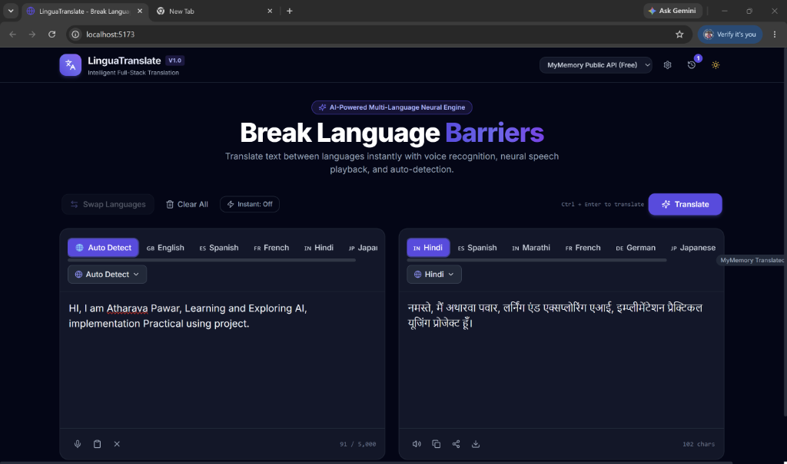

# 🌐 LinguaTranslate — Full-Stack Language Translation Web Application

**LinguaTranslate** is a modern, responsive, full-stack language translation web application inspired by Google Translate. Built with **React.js, Vite, Tailwind CSS, Node.js, and Express.js**, it allows users to translate text across 40+ global languages in real-time using authentic translation providers.

---

## 📸 Application Preview



---

## ✨ Features

- **Side-by-Side Dual Panels**: Clean and modern UI with responsive source and target panels.
- **40+ Languages Supported**: Including English, Hindi (हिन्दी), Marathi (मराठी), Spanish (Español), French (Français), German (Deutsch), Japanese (日本語), Chinese (中文), Arabic (العربية), and more.
- **Auto-Detection**: Automatic detection of input languages with real-time feedback.
- **Modular Translation Providers**:
  - **Google Cloud Translation API (v2 REST)**: Industry-standard enterprise neural translation.
  - **Microsoft Azure Translator (v3 Cognitive Services)**: High-precision cloud translation.
  - **MyMemory Public API (Free)**: Zero-config real translation API enabled out-of-the-box for instant testing without requiring credit cards or API keys.
- **Voice Recognition (Speech-to-Text)**: Speak directly into the microphone via the browser's Web Speech API.
- **Neural Text-to-Speech (TTS Audio Playback)**: Listen to translated pronunciations matching destination language voices.
- **One-Click Copy & Download**: Copy translated text to the clipboard with animated checkmark and toast notifications, or download as a text file.
- **Instant Language Swapping**: Seamlessly invert source and target languages with fluid 180° rotation animations.
- **Translation History**: Automatically persists recent translations to `localStorage` with timestamps and one-click restoration.
- **Dark & Light Mode**: Sleek dark and light themes with smooth transitions and persistent system preferences.
- **Keyboard Shortcuts**:
  - `Ctrl + Enter` (or `Cmd + Enter`): Instantly trigger translation.
  - `Ctrl + Shift + S` (or `Cmd + Shift + S`): Swap source and destination languages.
- **Security & Reliability**:
  - API credentials stored strictly on the server (`.env`).
  - Rate limiting (120 req / 15 min per IP) to prevent abuse.
  - Input length validation (up to 5,000 characters) and strict JSON payload limits.
  - Graceful, informative error reporting when credentials are missing or services fail.

---

## 🛠️ Technology Stack

| Layer | Technology |
|---|---|
| **Frontend** | React 18, Vite 6, Tailwind CSS 3, Lucide React Icons |
| **Backend** | Node.js (v18+ / v20+ / v24+), Express.js 4, CORS, express-rate-limit |
| **Translation Engine** | Google Cloud Translation API, Azure Translator, MyMemory Public API |
| **Speech APIs** | Web Speech API (`SpeechRecognition` & `SpeechSynthesis`) |
| **Environment** | `dotenv` configuration |

---

## 📁 Project Structure

```
project1/
├── client/                     # Frontend React (Vite) Application
│   ├── src/
│   │   ├── components/
│   │   │   ├── ConfigGuideModal.jsx   # API setup dialog & provider switcher
│   │   │   ├── ControlsBar.jsx        # Swap, clear all, and translate buttons
│   │   │   ├── Footer.jsx             # Language coverage & security badge
│   │   │   ├── HistoryDrawer.jsx      # Translation history slide-over panel
│   │   │   ├── LanguageSelector.jsx   # Searchable dropdown + popular pills
│   │   │   ├── Navbar.jsx             # Brand logo, provider pill, theme toggle
│   │   │   ├── SourcePanel.jsx        # Source textarea, microphone, char count
│   │   │   ├── Toast.jsx              # Floating notification alert system
│   │   │   └── TranslationPanel.jsx   # Output display, TTS speaker, copy button
│   │   ├── hooks/
│   │   │   ├── useSpeechRecognition.js# Web Speech speech-to-text hook
│   │   │   ├── useSpeechSynthesis.js  # Web Speech text-to-speech audio hook
│   │   │   └── useTheme.js            # Dark/light theme management hook
│   │   ├── services/
│   │   │   └── api.js                 # API client for backend communication
│   │   ├── App.jsx                    # Main application orchestration
│   │   ├── index.css                  # Tailwind styles and custom scrollbar
│   │   ├── languages.js               # Language registry and flag icons
│   │   └── main.jsx                   # React DOM root entry
│   ├── index.html                     # HTML root with Inter font & SEO meta
│   ├── package.json                   # Client dependencies & scripts
│   ├── postcss.config.js              # PostCSS configuration
│   ├── tailwind.config.js             # Tailwind CSS theme configuration
│   └── vite.config.js                 # Vite configuration with proxy to port 5000
│
├── server/                     # Backend Node.js & Express API
│   ├── routes/
│   │   └── translate.js               # POST /api/translate route with validation
│   ├── services/
│   │   └── translationService.js      # Modular provider adapters (Google, Azure, MyMemory)
│   ├── languages.js                   # Server language codes and validation helper
│   ├── server.js                      # Express app, CORS, rate-limiting, and routes
│   ├── .env.example                   # Template environment variables
│   ├── .env                           # Local environment configuration (git ignored)
│   └── package.json                   # Server dependencies & scripts
│
├── .gitignore                         # Git exclusion rules
├── package.json                       # Root workspace management
└── README.md                          # Project documentation
```

---

## 🚀 Getting Started

### 1. Prerequisites
- **Node.js** v18.0.0 or higher
- **npm** v9.0.0 or higher

### 2. Installation

Clone or open the project folder in your terminal:

```bash
cd project1
```

Install server and client dependencies:

**Option A (Separate folders):**
```bash
# Install backend dependencies
cd server
npm install

# Install frontend dependencies
cd ../client
npm install
```

---

## ⚙️ Environment Variables & API Setup

The server uses a `.env` file to securely store API credentials without exposing them to the frontend.

### Step 1: Create your server `.env`
In the `server/` directory, copy `.env.example` to `.env`:

```bash
cd server
cp .env.example .env
```
*(On Windows PowerShell: `copy .env.example .env`)*

### Step 2: Configure your chosen translation provider

The `.env` file contains:

```env
# Server Port
PORT=5000

# Client Origin (for CORS)
CLIENT_URL=http://localhost:5173

# Translation Provider: 'google' | 'azure' | 'mymemory'
TRANSLATION_PROVIDER=google

# Google Cloud Translation API Key
GOOGLE_TRANSLATE_API_KEY=your_google_cloud_api_key_here

# Microsoft Azure Translator (optional)
AZURE_TRANSLATOR_KEY=your_azure_translator_key_here
AZURE_TRANSLATOR_REGION=eastus
```

---

### How to Obtain API Credentials

#### Option 1: Google Cloud Translation API (Recommended for Production)
1. Visit the [Google Cloud Console](https://console.cloud.google.com).
2. Create a new project or select an existing one.
3. In the navigation menu, go to **APIs & Services > Library**.
4. Search for **Cloud Translation API** and click **Enable**.
5. Navigate to **APIs & Services > Credentials**.
6. Click **Create Credentials** and select **API Key**.
7. Copy your new API key.
8. Paste it into `server/.env`:
   ```env
   TRANSLATION_PROVIDER=google
   GOOGLE_TRANSLATE_API_KEY=AIzaSy...your_actual_key...
   ```
*(Google Cloud provides a free tier of 500,000 characters translated per month).*

#### Option 2: Microsoft Azure Translator
1. Sign in to the [Azure Portal](https://portal.azure.com).
2. Click **Create a resource** and search for **Translator** (Cognitive Services).
3. Select the free pricing tier (**F0** - 2,000,000 characters/month free).
4. Go to **Resource Management > Keys and Endpoint**.
5. Copy **Key 1** and the **Location/Region**.
6. Add them to `server/.env`:
   ```env
   TRANSLATION_PROVIDER=azure
   AZURE_TRANSLATOR_KEY=your_azure_key
   AZURE_TRANSLATOR_REGION=your_azure_region
   ```

#### Option 3: Instant Free Testing (No API Key Required)
If you do not have an API key and want to test real translations immediately:
1. In `server/.env`, set:
   ```env
   TRANSLATION_PROVIDER=mymemory
   ```
2. Or use the provider dropdown at the top-right of the frontend UI to switch to **"MyMemory Public API (Free)"**.
3. All translations will execute in real-time via the public Translated.net API.

---

## 🏃 Running the Application Locally

Run the backend and frontend simultaneously:

### 1. Start the Backend Server:
```bash
cd server
npm run dev
```
The server will start on **`http://localhost:5000`**.

### 2. Start the Frontend Client:
In a separate terminal window:
```bash
cd client
npm run dev
```
The Vite development server will start on **`http://localhost:5173`**.

Open your browser and navigate to **`http://localhost:5173`**.

---

## 📡 API Endpoint Documentation

### `POST /api/translate`
Translates text from a source language to a target language.

#### Request Headers:
```http
Content-Type: application/json
```

#### Request Body:
```json
{
  "text": "Hello, how are you?",
  "sourceLanguage": "en",
  "targetLanguage": "hi",
  "provider": "google"
}
```
*Note: `sourceLanguage` can be set to `"auto"` for automatic detection. `provider` is optional and defaults to the server's configured provider.*

#### Success Response (`200 OK`):
```json
{
  "success": true,
  "translatedText": "नमस्ते, आप कैसे हैं?",
  "detectedLanguage": "en",
  "provider": "google",
  "providerDisplayName": "Google Cloud Translation API"
}
```

#### Error Response — Missing API Key (`503 Service Unavailable`):
```json
{
  "success": false,
  "error": "API_KEY_NOT_CONFIGURED",
  "message": "Google Cloud Translation API key is not configured...",
  "provider": "google",
  "setupGuide": {
    "step1": "Sign in to Google Cloud Console...",
    "step2": "Enable Cloud Translation API...",
    "step3": "Add GOOGLE_TRANSLATE_API_KEY in server/.env"
  }
}
```

---

### `GET /api/languages`
Returns the complete list of 40+ supported languages, ISO language codes, native names, country flags, and text directions.

#### Response (`200 OK`):
```json
{
  "success": true,
  "count": 40,
  "languages": [
    { "code": "auto", "name": "Auto Detect", "nativeName": "Detect Language", "flag": "🌐", "isSourceOnly": true },
    { "code": "en", "name": "English", "nativeName": "English", "flag": "🇬🇧" },
    { "code": "hi", "name": "Hindi", "nativeName": "हिन्दी", "flag": "🇮🇳" },
    { "code": "mr", "name": "Marathi", "nativeName": "मराठी", "flag": "🇮🇳" },
    { "code": "es", "name": "Spanish", "nativeName": "Español", "flag": "🇪🇸" }
  ]
}
```

---

### `GET /api/status`
Returns server operational health, active provider, and configuration status.

#### Response (`200 OK`):
```json
{
  "success": true,
  "service": "LinguaTranslate Backend API",
  "status": "online",
  "activeProvider": "google",
  "providers": {
    "google": { "name": "google", "displayName": "Google Cloud Translation API", "isConfigured": true },
    "azure": { "name": "azure", "displayName": "Microsoft Azure Translator", "isConfigured": false },
    "mymemory": { "name": "mymemory", "displayName": "MyMemory Translated API (Free Public)", "isConfigured": true }
  }
}
```

---

## 🔧 Troubleshooting

| Issue | Cause | Solution |
|---|---|---|
| **"Google Cloud Translation API key is not configured"** | The key in `server/.env` is missing or contains the placeholder string. | Add your actual API key to `server/.env` or switch the provider to `mymemory` in the UI or `.env`. |
| **"Microphone error: permission denied"** | Browser microphone permissions blocked. | Click the camera/microphone icon in the browser address bar and choose "Allow". |
| **"Speech recognition is not supported in this browser"** | Browser does not implement Web Speech API. | Use Google Chrome, Microsoft Edge, or a Chromium-based browser which natively supports speech recognition. |
| **CORS error on translation requests** | Frontend is accessing the server directly on an unlisted port. | Ensure requests route through the Vite proxy (`/api/...`) or update `CLIENT_URL` in `server/.env`. |
| **Translation rate limit exceeded** | Sent more than 120 requests in 15 minutes. | Wait 15 minutes or adjust the `windowMs` and `max` settings in `server/server.js`. |

---

## 🔒 Security Best Practices Implemented

1. **Server-Side API Secrecy**: No API credentials or private keys are bundled or exposed in client-side code.
2. **Input Sanitization & Validation**: Strings are length-checked and bounded to a 5,000 character maximum.
3. **Payload Limitations**: Express payload size limit fixed to 50KB to protect against DOS attacks.
4. **Rate Limiting**: IP-based sliding window rate limiter protects endpoints from bot abuse.
5. **Safe Error Masking**: Internal stack traces and credential details are stripped from client responses.

---


